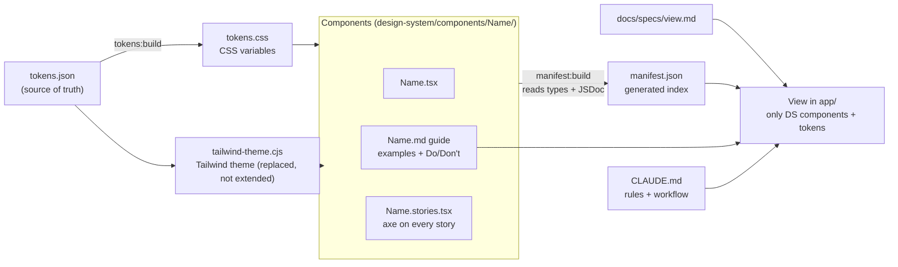

# Design system for LLMs + Asiakkaat (Customers) view

A design system built so that an LLM can use it without guessing, and a Finnish B2B customer management view built from a written spec as proof.

**Why this project (FI):** Tekoälyn tekemä käyttöliittymä näyttää usein hyvältä mutta rikkoo suunnittelujärjestelmän: keksittyjä värejä, omia nappeja, puuttuvia saavutettavuusasioita. Tässä projektissa suunnittelujärjestelmä on rakennettu niin, että väärin tekeminen on vaikeaa: vain tokenit, koneluettava komponenttihakemisto ja tarkistukset, jotka kaatavat virheelliset muutokset. Todisteena on asiakasnäkymä, jonka Claude Code rakensi kirjoitetusta speksistä.

**Why this project (EN):** AI-generated UI often looks fine but breaks the design system: invented colors, hand-built buttons, missing accessibility. Here the system is built so the wrong thing is hard to do: token-only styling, a machine-readable component index, and checks that fail bad changes. The proof is a customers view that Claude Code built from a written spec.

- **Live demo:** `<DEMO_URL>` (placeholder, fill in after deploy)
- **Storybook:** `<STORYBOOK_URL>` (placeholder, fill in after deploy)

## Screenshots

Captured with `npm run screenshots` (real 375 px and 1280 px viewports).

| Desktop 1280 px | Mobile 375 px |
|---|---|
|  |  |
|  |  |
|  |  |
|  |  |

More states (both details tabs, error and empty at both widths) are in `docs/screenshots/`.

## The idea

Most design systems are written for people. This one is written for an LLM that has to build views from it:

1. **One source of truth.** `design-system/tokens/tokens.json` holds colors, type, spacing, radii, shadows and breakpoints.
2. **Components with fixed variants.** 14 components (Button, Input, Select, Table, Dialog, ...). They take `variant`/`tone`/`size`, never `className`.
3. **A manifest.** `design-system/manifest.json` is generated from the component source: description, props, variants, required accessibility props, guide path. An LLM reads it first to choose components.
4. **Guides with rules.** Each component has a `.md` guide with examples and "Don't" rules.
5. **A spec to view workflow.** A view starts as `docs/specs/<view>.md`. The Customers view was built from `docs/specs/customers.md`.

## Architecture



## What makes it LLM-reliable

| Mechanism | What it prevents |
|---|---|
| **Token-only Tailwind theme.** The theme is replaced by tokens, so `bg-blue-500` or `p-[13px]` do not exist. | Invented colors and spacing |
| **ESLint rules.** No arbitrary Tailwind values, hex colors or inline `style`; no `@radix-ui/*` imports outside `design-system/`; views import only from the barrel `@/design-system/components`. | Style drift and leaking implementation details |
| **No `className` on components.** Looks change by adding a variant to the component. | One-off overrides in views |
| **`manifest.json`** (generated, never hand-edited). | Guessing which components and props exist |
| **Per-component guides** with Do/Don't rules. | Misusing a component |
| **`CLAUDE.md`** with non-negotiable rules, Finnish copy conventions and the spec to view workflow. | Skipping steps |
| **Check scripts.** `tokens:check` and `manifest:check` fail on stale generated files; `verify` also runs typecheck, lint, Storybook tests (axe on every story, a violation fails) and the Playwright tests. | Silent regressions |

## How Claude Code built the Customers view

From `docs/specs/customers.md`, one commit per step:

1. **Spec.** Read the spec and added the sections the template requires (status, Finnish copy table, out of scope) without changing its content.
2. **Component audit.** Checked `manifest.json` and the guides against what the view needs. Found gaps: a loading placeholder, a read-only term/value list, a layout primitive for rows and forms, and a page container with a header.
3. **Design system additions first.** Skeleton, DescriptionList, Stack (token-only `gap`, `direction`, `switchAt`; no `className`), PageHeader and Page, each with a story, guide and manifest entry.
4. **The view.** `app/customers/`: mock data, formatters and pure logic in separate files, client view, two dialogs. Invoice status is derived from a fixed `DEMO_TODAY`, so the demo is deterministic. Unit tests cover filtering, sorting, validators, invoice status and formatting.
5. **Checks.** `manifest:check`, `tokens:check`, lint, `tsc`, `next build`, `build-storybook`.
6. **Browser verification.** The real page at 375 px and 1280 px, keyboard-only use (filters, sorting, both dialogs, focus return), all states.
7. **Manual review fixes.** A human review found real issues, fixed in the design system, not in the view:
   - the status Select was empty before hydration (the label is now rendered directly);
   - fields in one row were misaligned because the hint sat above the control (the hint now sits below);
   - the row action was off-screen on mobile (the customer name is now the button, via a `link` Button variant);
   - the scrolling table now has a labelled, focusable region, a flush variant inside Cards and an edge shadow cue.
8. **End-to-end tests.** Playwright + axe on the live page and keyboard/focus tests at both widths.

## Scripts

| Command | What it does |
|---|---|
| `npm run dev` | Next dev server (regenerates tokens first) |
| `npm run build` / `npm start` | Production build / serve it |
| `npm run storybook` | Storybook on :6006 |
| `npm run build-storybook` | Static Storybook build into `storybook-static/` |
| `npm run tokens:build` / `tokens:check` | Generate `tokens.css` / fail if stale |
| `npm run manifest:build` / `manifest:check` | Generate `manifest.json` / fail if stale |
| `npm run check` | `tokens:check` + `manifest:check` |
| `npm run typecheck` | `tsc --noEmit` (strict) |
| `npm run lint` | ESLint, including the style and import rules |
| `npm test` | Vitest: every story in headless Chromium with axe, plus unit tests for the Customers logic |
| `npm run test:e2e` | Playwright against the production build at 375 px and 1280 px: axe in all states, keyboard and focus tests |
| `npm run verify` | `check` + `typecheck` + `lint` + `test` + `test:e2e`; run before every commit |
| `npm run screenshots` | Build, start, and capture `docs/screenshots/` |

First run needs a browser: `npx playwright install chromium`.

## Project structure

```
design-system/
  manifest.json          generated component index
  build-manifest.mjs
  tokens/                tokens.json (source), tokens.css (generated), tailwind-theme.cjs
  components/<Name>/     <Name>.tsx, .stories.tsx, .md
  components/index.ts    public barrel
  lib/                   shared helpers (cn, field, icons, focus ring)
app/
  customers/             view, dialogs, data/, lib/ (pure logic + unit tests)
docs/
  specs/                 view specs (customers.md, _template.md)
  screenshots/           generated by npm run screenshots
e2e/                     Playwright tests (axe, keyboard and focus)
scripts/screenshots.mjs
CLAUDE.md                rules and workflow for LLMs
```

## Tech stack

Next.js 16 (App Router), React 19, TypeScript (strict), Tailwind CSS 3 (token theme), Radix UI primitives (inside the design system only), class-variance-authority, Storybook 10 with the a11y addon, Vitest 4, Playwright with axe-core.

## Deployment (Vercel, two projects)

Both builds are verified from a clean clone (`npm ci`, `npm run build`, `npm run build-storybook`). Nothing is deployed yet. The repo has no `vercel.json` on purpose: it would apply to both projects, so each project is configured in its Vercel settings.

Create two Vercel projects from the same Git repository:

| | App | Storybook |
|---|---|---|
| Framework preset | Next.js | Other |
| Root directory | `./` | `./` |
| Install command | `npm ci` (default) | `npm ci` |
| Build command | `npm run build` (default) | `npm run build-storybook` |
| Output directory | default (`.next`) | `storybook-static` |
| Node.js version | 20.x or newer | 20.x or newer |
| Environment variables | none | none |

Steps:

1. Push the repository to GitHub.
2. In Vercel, **Add New... > Project**, import the repository, keep the Next.js preset and deploy. This is the app.
3. Add a second project from the same repository. Set the framework preset to **Other** and override the build command and output directory as in the table. This is Storybook.
4. Copy both URLs into the placeholders at the top of this README (`<DEMO_URL>`, `<STORYBOOK_URL>`).

The app redirects `/` to `/customers` (see `next.config.ts`). Both builds run `tokens:build` first (`prebuild` and `prebuild-storybook`), so `tokens.css` is always fresh.

## Limitations

- All data is fictional and lives in `app/customers/data/`. There is no backend and no persistence: a customer you add is lost on reload.
- Loading (about 500 ms) and the error state are simulated. `?state=error` shows the error on the first load; "Yritä uudelleen" then succeeds.
- Finnish only; text is hardcoded, there is no i18n layer.
- Select focus on error: the form moves focus to the first invalid field by `id`, and `Select` supports `id` and `ref`, so this works. The Customers form has no validation on its Select, so that path is not exercised in the UI.
- Screenshots are stable on one machine; fonts are the system font stack, so other operating systems render slightly differently.
- Not audited with a screen reader: axe and keyboard tests only.

## License

[MIT](LICENSE)
